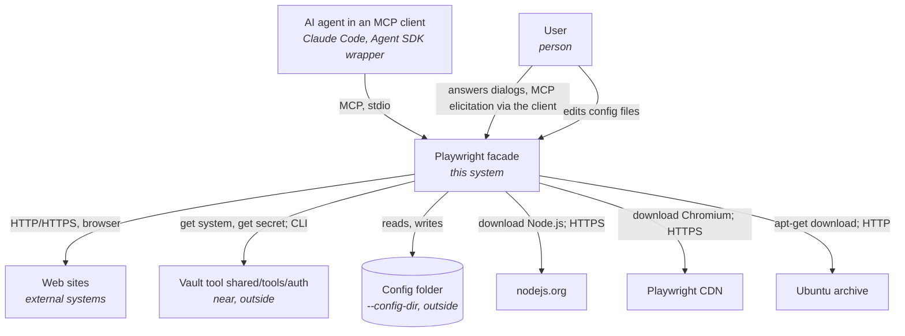
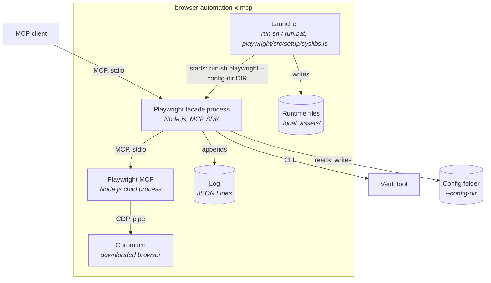
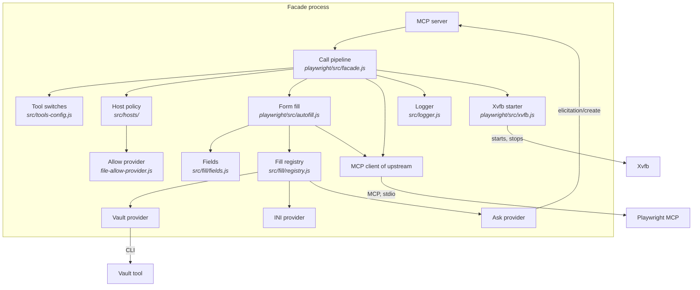
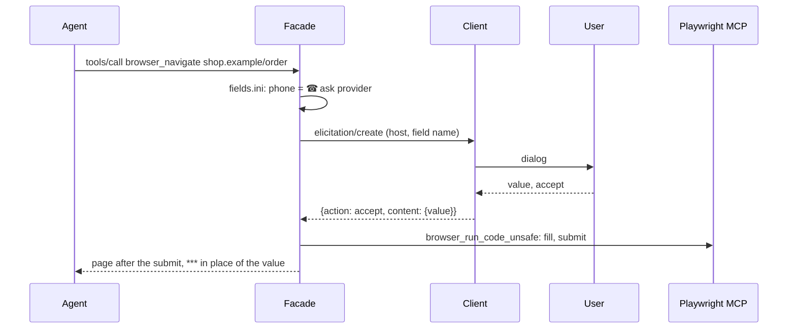

# Design — browser-automation-x-mcp

The intended architecture. For the reasons, see [ADL.md](ADL.md). Values in uppercase are
defined in [SRS.md](SRS.md#default-values) and [QAS.md](QAS.md#default-values).

## 1. Overview

The tool holds facades for browser tools. Each facade has its own folder (`playwright/`). The
facades share the launcher, the runtime, the code in `src/`, the form-fill providers
(`providers-form-fill/`) and the config templates in `config/`. The config files are in a config
folder of the repository that uses the tool, e.g. `local/configs/browser-automation-x-mcp`. A
second facade is an open issue (section 11).

The Playwright facade is an MCP server on stdio between an MCP client (Claude Code, a wrapper with
the Agent SDK) and Playwright MCP. It forwards the browser tools, and it adds tool switches, an
automatic form fill and host lists. It runs without root and without OS installs.

The facade is opaque to the agent. The agent sees the server `browser-automation-x-mcp` with the
browser tools. No text for the agent names the facade, Playwright, the form fill or its providers
(REQ-005 of SRS). Deny rules of the agent tools close the tool folder and the config folder to the
agents (section 9).

## 2. Architectural drivers

- Functional requirements: [SRS.md](SRS.md)
- Quality attributes: [QAS-001](QAS.md#qas-001--portable-start-on-ubuntu) to [QAS-005](QAS.md#qas-005--overhead-of-the-facade)
- Constraints:
  - The tool lives in the `shared` container. It writes files only into its folder (rules
    nothing-outside-repo, per-project-runtimes).
  - Secrets come only from the vault tool `shared/tools/auth` (rule credentials-from-vault).
  - No OS package installs, no root.
  - The client starts the facade as a child process (stdio).

## 3. System context (C4 level 1)

System boundary: the tool folder `shared/tools/browser-automation-x-mcp/`. The vault tool and
the vault home are near, but outside.



- **AI agent in an MCP client:** calls the browser tools. It does not know the form fill. It gets
  the page after the submit, with MASK in place of masked values.
- **User:** configures the tool, edits the host list, answers the dialogs of the ask provider.
- **Web sites:** the pages that the agent opens.
- **Vault tool:** gives the secrets of the vault provider.
- **nodejs.org, Playwright CDN, Ubuntu archive:** the sources of the runtime, the browser and the
  missing Linux libraries.

## 4. Containers (C4 level 2)



- **Launcher:** one for all facades. It makes and updates the shared runtime: Node.js, npm
  packages, and for the Playwright facade Chromium and the missing Linux libraries and fonts.
  Then it starts the facade that its first argument names. stdout stays free for MCP.
- **Playwright facade process:** the MCP server for the client and the MCP client of Playwright
  MCP. It runs the call pipeline (section 5.1). An other facade is an other process of the same
  kind, with its own folder.
- **Playwright MCP:** `@playwright/mcp`, unchanged. It runs the browser tools.
- **Chromium:** the browser of Playwright, from the tool folder.
- **Xvfb:** the virtual display of a headed browser on Linux without a display. The facade
  starts and stops it. Unpacked into the tool folder.
- **Config folder:** outside the tool folder; `--config-dir` gives it (REQ-019 of SRS). Shared by
  all facades: `facade.ini`, `fields.ini`, `host-policy.ini`, `provider-<name>.ini`. For one facade:
  `<facade>-tools.ini`. A missing file is a copy of its template in the tool folder. The facade
  adds tool lines and records hosts.
- **Log:** `LOG_FILE`, gitignored.
- **Runtime files:** Node.js, browsers, libraries, profiles, temp files, DISCOVERED_FILE;
  gitignored.
- **Output files:** OUTPUT_DIR in the working folder: snapshots and screenshots for the agent.

## 5. Components (C4 level 3)

### 5.1 Playwright facade process

The components with a path in `src/` and `providers-form-fill/` are shared: each facade process
loads them. The components with a path in `playwright/` are for this facade only.



- **MCP server / MCP client:** the SDK objects for the two connections. The facade forwards
  roots, progress, cancellation and tool-list changes between them.
- **Call pipeline:** the steps of one call, in this order: tool switch → host check of the target
  URL → upstream → host check of the opened page and record → discovery (DISCOVER) → form fill →
  host check of the page after the submit → scrub → removal of the code sections → log.
- **Tool switches:** `src/tools-config.js` with `playwright-tools.ini` and the dangerous
  tools of Playwright MCP; adds missing tools; gives the error of a disabled tool.
- **Host policy:** `[deny]` first, then the allow provider. Patterns: `src/hosts/patterns.js`.
- **Allow provider:** the default reads `[allow]` and records each opened host.
- **Form fill:** `playwright/src/autofill.js`. It runs page code through `browser_run_code_unsafe`
  of upstream: find the fields, fill them, submit, wait (REQ-030, REQ-038 of SRS). The tool switch
  of the agent does not apply to these calls. Their results never go to the agent. It keeps the
  loop guard of the session. In the discovery mode, it writes DISCOVERED_FILE (REQ-039).
- **Fields:** `src/fill/fields.js` reads `fields.ini`, matches URL patterns and makes the pattern of
  a page (REQ-037).
- **Fill registry:** loads the providers in the order of `facade.ini`, gives the value of a field
  name, and scrubs the values of masked providers from the results and from the text files that
  upstream wrote in the call (REQ-032).
- **Vault, INI, ask providers:** `providers-form-fill/<name>/index.js` with `provider-<name>.ini`.
  The vault provider uses only the systems that `[systems]` names (REQ-034 of SRS).
- **Xvfb starter:** `playwright/src/xvfb.js`. `renderMode()` of `playwright/src/config.js`
  resolves `RENDER_MODE` (REQ-015 of SRS). For `HEADED_INVISIBLE`, the facade starts
  Xvfb through `setpriv --pdeathsig KILL` before upstream, records it in XVFB_DIR and gives
  `DISPLAY` to upstream. At each start, it kills the Xvfb of facades that do not run (REQ-018).
- **Chrome settings:** `playwright/src/chrome-prefs.js` writes `CHROME_PREFS` into the persistent
  profile before the browser starts: at the first call, and after `browser_close`.
- **Logger:** JSON Lines; redacts the secret arguments.

### 5.2 Launcher

- **`run.sh` / `run.bat`:** steps 1–4: Node.js (checksum), npm packages (when
  `package-lock.json` changes), Chromium (for each Playwright version), Linux libraries.
- **`playwright/src/setup/syslibs.js`:** `ldd` → soname → package (Debian rule and an exception table) →
  `apt-get download` → `dpkg-deb -x`, in rounds; private apt lists if the system has none; fonts;
  Xvfb with the patched path of `xkbcomp` (REQ-017 of SRS).

## 6. Interfaces

### 6.1 Container interfaces

| Container | Operation | Description |
| --- | --- | --- |
| Facade process | MCP `initialize` | Gives SERVER_NAME, the tools capability of upstream and the instructions of REQ-005. |
| Facade process | MCP `tools/list` | The tools of upstream without the name Playwright; notes for disabled tools. |
| Facade process | MCP `tools/call` | The call pipeline (5.1). Error results: UI-02 of SRS. |
| Facade process | MCP `elicitation/create` (to the client) | The dialog of the ask provider (UI-01). |
| Facade process | arguments | `--config-dir DIR` (necessary; REQ-019 of SRS). Each other argument goes to Playwright MCP, e.g. `--isolated`. The facade removes `--headless`. |
| Facade process | environment | `RENDER_MODE` (REQ-015 of SRS; the facade ignores `PLAYWRIGHT_MCP_HEADLESS`); `BROWSER_AUTOMATION_X_MCP_LOG_FILE`, `_LOG_LEVEL`, `_LOG_SECRETS`, `_DISCOVER`; `BROWSER_AUTOMATION_X_MCP_VAULT_TOOL` (tests: a test double of the vault tool). |
| Playwright MCP (used) | `browser_run_code_unsafe`, `browser_snapshot` | Page code of the form fill; the snapshot after the submit. |
| Launcher | `run.sh [install|test|args]` | Makes the runtime; `install` stops after it; `test` runs the tests. |
| Vault tool (used) | `run.sh --vault NAME get-system SYSTEM` / `get-secret SYSTEM KEY` | The secret names of one system; one secret on stdout. |

### 6.2 Component interfaces

| Component | Interface | Used by |
| --- | --- | --- |
| Fill provider | `resolve(name, ctx)`: value, `undefined`, or a `FillError`; `dispose()`. `ctx = { host, url, elicit }`. See `src/fill/provider.js`. | Fill registry |
| Fields | `match(url)` → `{ key, fields: [{ name, selector }], submit }` or `undefined`; `urlMatches(pattern, url)`; `urlPattern(url)` | Form fill |
| Form fill | `autofill(session, url, ctx)` → snapshot result or `undefined`; `discover(session, url)` | Call pipeline |
| Allow provider | `isAllowed(host, ctx)`; `recordOpened(host, ctx)`. `ctx = { url, tool }`. See `src/hosts/allow-provider.js`. | Host policy |
| Host policy | `check(url, ctx)` → `{ allowed, reason }`; `opened(url, ctx)` | Call pipeline |
| Tool switches | `addMissing(names)`, `isEnabled(name)`, `describe(tool)`, `disabledResult(name)` | Call pipeline |
| Fill registry | `resolve(name, ctx)`, `scrub(result)`, `scrubFiles(files)`, `clean(text)` | Form fill, call pipeline |

## 7. Key flows

Form fill of a login page:

```mermaid
sequenceDiagram
    Agent->>Facade: tools/call browser_navigate login.example/u/login
    Facade->>Playwright MCP: browser_navigate
    Playwright MCP-->>Facade: result, Page URL: login.example/u/login
    Facade->>Facade: host check; fields.ini matches login.example/u/*
    Facade->>Playwright MCP: browser_run_code_unsafe: wait for the fields (FILL_WAIT)
    Facade->>Vault provider: resolve("password", host)
    Vault provider->>Vault tool: get-secret "System" password
    Vault tool-->>Vault provider: secret
    Facade->>Playwright MCP: browser_run_code_unsafe: fill, submit, wait (SUBMIT_WAIT)
    Facade->>Playwright MCP: browser_snapshot
    Playwright MCP-->>Facade: page after the submit (may show a value)
    Facade->>Facade: host check; scrub: value → ***; remove code sections
    Facade-->>Agent: page after the submit
```

A redirect to a denied host:


Dialog of the ask provider:



## 8. Data model

| File | Committed | Format | Written by |
| --- | --- | --- | --- |
| `<config>/facade.ini` | yes | `[fill] providers = vault, ini, ask`; `[mask]` `<provider> = true|false`; `[hosts] record = true|false` | user |
| `<config>/fields.ini` | yes | `[<URL pattern>]` with `<field name> = <CSS selector>` and `submit = <CSS selector>` (REQ-037 of SRS) | user |
| `<config>/playwright-tools.ini` | yes | `[tools]` `<tool> = enabled|disabled`, sorted | user; facade adds missing tools |
| `<config>/host-policy.ini` | yes | header comments; `[deny]`, `[allow]`: one host pattern per line, sorted, unique | user; facade records hosts |
| `<config>/provider-vault.ini` | yes | `[vault]` `vault = vault-<name>`; `[systems]` `<host or URL prefix> = <system name>` | user |
| `<config>/provider-ini.ini` | yes | `[values]` with `<field name> = <value>` | user |
| `<config>/provider-ask.ini` | yes | `[ask]` `fields = a, b, c` | user |
| `config/*.template.ini`, `<facade>/config/tools.template.ini`, `providers-form-fill/<name>/config.template.ini` | yes | the first content of each file above | user; facade copies a template to a missing file |
| `LOG_FILE` | no | JSON Lines: `ts`, `level`, `session`, `event`, fields of the event | facade |
| `.local_assets/` | no | runtime, browsers, `syslibs/<platform>/root` (also Xvfb), `xvfb/<display>.json` (PID and start time of facade and Xvfb), profiles, tmp, `discovered-fields.ini` | launcher, Playwright, facade |
| OUTPUT_DIR | no | snapshots, screenshots, console logs of upstream | Playwright; facade scrubs |
| `<repo>/.local_assets/tmp/` | no | temp files of Chromium when the tool folder cannot hold its socket | Playwright |

Host patterns: `*` (each host), `*.example.com` (subdomains only), `example.com` (exact),
`192.168.1.*` (IPv4 octets). Host only, no case. A URL without a host passes.

URL patterns: `host/path`; the host part is a host pattern; `*` in the path matches each sequence of
characters. A pattern without a path matches each path.

`<config>` is the config folder that `--config-dir` gives, e.g. `local/configs/browser-automation-x-mcp`
of the repository.

## 9. Deployment

- Deployment, configuration and client setup: [README.md](../README.md).
- The deny rules of the agent tools close the tool folder, the config folder and `.mcp.json` to the
  agents: `permissions.deny` in the root `.claude/settings.json`, and the matching settings of the
  other agent tools. The output folder stays open.

| Dependency | Container | Use |
| --- | --- | --- |
| Node.js NODE_VERSION (downloaded) | Launcher, facade, Playwright MCP | Runtime |
| `@playwright/mcp` 0.0.83 | Playwright MCP | Browser tools |
| `@modelcontextprotocol/sdk` 1.32.2 | Facade process | MCP server and client |
| Chromium (downloaded) | Chromium | Browser |
| `ldd`, `apt-get`, `apt-cache`, `dpkg-deb` (Ubuntu base) | Launcher | Missing libraries, no root |
| `curl`, `tar`, `sha256sum` / `certutil` | Launcher | Download of Node.js |
| Vault tool `shared/tools/auth` | Vault provider | Secrets |

Manual test: see [README.md](../README.md#tests), and run `claude -p` with `--mcp-config` as
[README.md](../README.md#client-setup) says.

## 10. Architecture decisions

All decisions are in [ADL.md](ADL.md).

- [ADR-20261028-facade_folders](adr/ADR-20261028-facade_folders.md): one folder for each facade, shared
  providers and config.

## 11. Open issues

- A second facade, for the browser that Claude opens in a chat of the Claude desktop app.
- A pop-up allow provider (MCP elicitation) for hosts that are not in `[allow]`.
- A network fill provider.
- Proof of QAS-001 in clean Ubuntu 22.04 and 24.04 containers, with instructions (B3).
- CJK fonts (`fonts-noto-cjk`, 58 MB) for screenshots of Chinese, Japanese and Korean text.
- `libgssapi-krb5-2` for Kerberos sign-on on hosts without it (lazy-loaded by Chromium).
- In `claude -p` (no UI), Claude Code cancels each dialog of the ask provider. The facade does not fill
  the form.
- `browser_evaluate` can read a value that stays in a field after a failed submit.
- A deny rule does not stop each shell command. An agent with a shell can still read the tool
  folder.

## 12. Default values

See [SRS.md](SRS.md#default-values) and [QAS.md](QAS.md#default-values).
