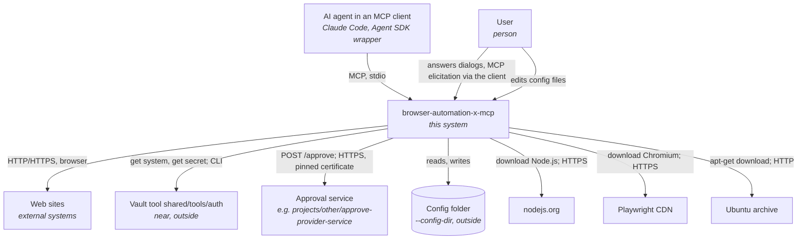
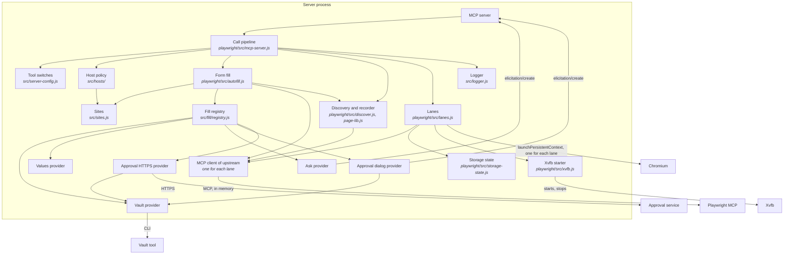
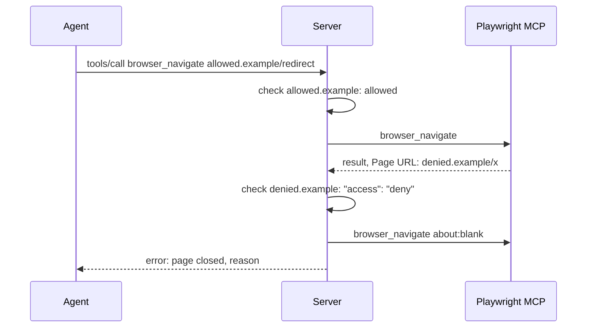

# Design — browser-automation-x-mcp

The intended architecture. For the reasons, see [ADL.md](ADL.md). Values in uppercase are
defined in [SRS.md](SRS.md#default-values) and [QAS.md](QAS.md#default-values).

## 1. Overview

The tool is an MCP server for browser automation. It runs on stdio between an MCP client (Claude
Code, a wrapper with the Agent SDK) and Playwright MCP. It forwards the browser tools, and it adds
tool switches, an automatic form fill, host lists and lanes. A lane is one browser context for one
agent: agents and sessions use the browser in parallel. It runs without root and without OS
installs. The browser is always Chromium.

The server code is in `playwright/`. The code in `src/`, the form-fill providers
(`providers-form-fill/`) and the config templates in `config/` are the parts that do not use
Playwright. The config files are in a config folder of the repository that uses the tool, e.g.
`local/configs/browser-automation-x-mcp`.

The internals are hidden from the agent. The agent sees the server `browser-automation-x-mcp` with
the browser tools. No text for the agent names upstream, Playwright, the form fill or its providers
(REQ-005 of SRS). Deny rules of the agent tools close the tool folder and the config folder to the
agents (section 9).

## 2. Architectural drivers

- Functional requirements: [SRS.md](SRS.md)
- Quality attributes: [QAS-001](QAS.md#qas-001--portable-start-on-ubuntu) to [QAS-005](QAS.md#qas-005--overhead-of-the-server)
- Constraints:
  - The tool lives in the `shared` container. It writes files only into its folder (rules
    nothing-outside-repo, per-project-runtimes).
  - Secrets come only from the vault tool `shared/tools/auth` (rule credentials-from-vault).
  - No OS package installs, no root.
  - The client starts the server as a child process (stdio).

## 3. System context (C4 level 1)

System boundary: the tool folder `shared/tools/browser-automation-x-mcp/`. The vault tool and
the vault home are near, but outside.



- **AI agent in an MCP client:** calls the browser tools. It does not know the form fill. It gets
  the page after the submit, with MASK in place of masked values.
- **User:** configures the tool, adds the credentials of a site, fills the forms in the discovery
  mode, answers the dialogs of the ask and approval providers.
- **Web sites:** the pages that the agent opens.
- **Vault tool:** gives the secrets of the vault provider.
- **Approval service:** approves or refuses a fill for the `approve-https` provider (REQ-036b of
  SRS). The workspace has a service that approves each request.
- **nodejs.org, Playwright CDN, Ubuntu archive:** the sources of the runtime, the browser and the
  missing Linux libraries.

## 4. Containers (C4 level 2)


- **Launcher:** makes and updates the runtime: Node.js, npm packages, Chromium and the missing
  Linux libraries and fonts. Then it starts the server with its arguments. stdout stays free for
  MCP.
- **Server process:** the MCP server for the client. It launches one Chromium and one Playwright
  MCP connection for each lane. It runs the call pipeline (section 5.1).
  It opens no network port.
- **Playwright MCP:** `@playwright/mcp`, unchanged, through `createConnection()` in the server
  process. It runs the browser tools in the context of a lane.
- **Chromium:** the browser of Playwright, from the tool folder. One process for each lane, with a
  persistent profile in LANES_DIR that the server writes before the start and deletes at the close
  (REQ-016, REQ-065 of SRS).
- **Storage state:** STATE_FILE: the cookies, localStorage and listed IndexedDB of all lanes and
  sessions of the workspace (REQ-064 of SRS). Mode `0600`; never in a result, a log or OUTPUT_DIR.
- **Xvfb:** the virtual display of a headed browser on Linux without a display. One for each
  server: it starts with the first lane and stops after the last lane. Unpacked into the tool
  folder.
- **Config folder:** outside the tool folder; `--config-dir` gives it (REQ-019 of SRS). It holds
  `server.json` (providers, tool switches) and `sites.json` (access, credentials and pages of
  sites). A missing file is a copy of its template in the tool folder. The server adds missing
  tools to `server.json`. Only the discovery mode writes `sites.json` (REQ-039a of SRS).
- **Log:** two files for each server start in LOG_DIR/`<client>`/: `.log` for a person and
  `.log.json` with all fields (REQ-050 of SRS); gitignored.
- **Runtime files:** Node.js, browsers, libraries, temp files, STATE_FILE; gitignored.
- **Output files:** OUTPUT_DIR in the working folder: snapshots and screenshots for the agent.

## 5. Components (C4 level 3)

### 5.1 Server process



- **MCP server / MCP client:** the SDK objects for the connections. The server forwards roots,
  progress and cancellation between the client and the connection of the lane.
- **Call pipeline:** the steps of one call, in this order: tool switch → lane tools, or the lane of
  the call (REQ-061 of SRS) → file name check (REQ-014a) → host check of the target URL → upstream
  → host check of the opened page → login link and form fill, with a host
  check of each page after a submit → scrub of masked values and secret headers (REQ-032,
  REQ-032a) → removal of the code sections → log. Each lane has its own call state (page URL, fill
  state, agent call times): an object with the shared session as its prototype. The discovery
  runs beside the calls, in the browser.
- **Lanes:** `playwright/src/lanes.js` (section 7 of SRS). Opens and closes lanes, keeps
  MAX_LANES and MAX_TABS_PER_LANE, closes idle lanes, and starts and stops the Chromium of each
  lane and the Xvfb of the server. It writes the lane profile with
  `playwright/src/chrome-prefs.js` (REQ-016), loads the storage state with `setStorageState()`,
  and adds a page script that reports the input of the user (REQ-066). At the start of the
  server, it deletes the lane profiles of servers that do not run.
- **Storage state:** `playwright/src/storage-state.js`. Reads STATE_FILE, removes the IndexedDB of
  hosts that no site of `sites.json` covers, merges the state of a lane into the file, and writes it
  with mode `0600` (REQ-064). The lanes save at each page load and at the close.
- **Server config:** `src/server-config.js` reads `server.json`: the providers that are on, in the
  order of the array, with their mask and settings.
- **Tool switches:** `src/server-config.js` with `tools` of `server.json` and the dangerous tools
  of Playwright MCP; adds missing tools; gives the error of a disabled tool.
- **Sites:** `src/sites.js` reads `sites.json`: the access of a host (deny wins, else the most
  specific site, else `defaultAccess`), the form of a URL (fields, submit, login of the matching
  pages) and the vault system of a URL (REQ-034, REQ-037, REQ-040 of SRS). A site covers its host
  and its subdomains.
- **Host policy:** `src/hosts/host-policy.js` checks the access of the sites.
- **Form fill:** `playwright/src/autofill.js`. It runs page code through `browser_run_code_unsafe`
  of upstream: find the fields, fill them, submit, wait (REQ-030, REQ-038 of SRS). The tool switch
  of the agent does not apply to these calls. Their results never go to the agent. It keeps the
  loop guard of the lane. Before the fill, it clicks a visible login link of `sites.json`, one time
  for each lane and host, if the vault provider has a system for the host (REQ-030a). It marks the
  elements that it touches with `__baxAuto` for the recorder. A blocked page after a submit stops
  the fill (REQ-030). In the discovery mode, it fills one time and does not submit.
- **Discovery:** `playwright/src/discover.js` (REQ-039, REQ-039a, REQ-042 of SRS). When a lane
  opens, `startDiscovery()` adds the recorder of `playwright/src/page-lib.js` to each frame, and the
  binding `__baxRecord` of the context. The recorder makes the selectors in the browser. It reports
  each fill, click and submit at once. At a click or a submit, it also gives the values of the
  fields that the form fill did not fill. The server logs each record without values, and gives it
  to the form fill, the agent (by the time of its calls) or the user. At a click or a submit, it
  gets the keys of the values of the user from the fill registry (`match`), discards the values,
  and writes `sites.json`. A navigation and the close of the lane write the fields that wait,
  without keys. At each page load, it writes the host. No agent call is necessary.
- **Sites writer:** `src/sites.js` (`updateSites()`). It reads `sites.json` again, changes the
  entries of one page or site, and writes the file in one step (REQ-039a).
- **Page code:** `playwright/src/run-code.js` runs a function in the page through
  `browser_run_code_unsafe`.
- **Fill registry:** loads the providers of `server.json` in their order, with the wrapped provider
  of each approval provider. It gives the values of the keys of one fill, with one approval for each
  approval provider (REQ-031, REQ-036c of SRS). It gives the key of a value from the key-value
  providers (REQ-039a). It scrubs the values of masked providers from the results and from the
  text files that upstream wrote in the call (REQ-032).
- **Providers:** `providers-form-fill/<type>/index.js`. The base classes are in
  `src/fill/provider.js`: `FillProvider` (value provider), `KeyValueProvider`, `ApprovalProvider`.
  The settings of a provider are the keys of its entry in `server.json`.
  - Key-value: `vault` (REQ-034) takes the vault system from the `credentials` of the site or
    page; `values` (REQ-035).
  - Value: `ask` (REQ-036).
  - Approval: `approve-dialog` (REQ-036a) and `approve-https` (REQ-036b). The `provider` key of the
    entry is the entry of the wrapped key-value provider.
- **Xvfb starter:** `playwright/src/xvfb.js`. `renderMode()` of `playwright/src/config.js`
  resolves `RENDER_MODE` (REQ-015 of SRS). For `HEADED_INVISIBLE`, the lanes start Xvfb through
  `setpriv --pdeathsig KILL` before Chromium, record it in XVFB_DIR and give its `DISPLAY` to
  Chromium. At each start, the server kills the Xvfb of servers that do not run (REQ-018).
- **Entry point:** `playwright/src/server.js` takes only `--config-dir`. It sets the browsers
  path, the cache folder, the temp folder and the libraries in the process environment before it
  loads Playwright: Playwright reads them once.
- **Logger:** `src/logger.js`. It keeps the events in a buffer until `initialize` gives the client
  name, then writes `.log.json` and the short lines of `.log`. It redacts the secret arguments.

### 5.2 Launcher

- **`run.sh` / `run.bat`:** steps 1–4: Node.js (checksum), npm packages (when
  `package-lock.json` changes), Chromium (for each Playwright version), Linux libraries.
- **`playwright/src/setup/syslibs.js`:** `ldd` → soname → package (Debian rule and an exception table) →
  `apt-get download` → `dpkg-deb -x`, in rounds; private apt lists if the system has none; fonts;
  Xvfb with the patched path of `xkbcomp` (REQ-017 of SRS).

## 6. Interfaces

### 6.1 Container interfaces

| Container | Operation | Description |
| --- | --- | --- |
| Server process | MCP `initialize` | Gives SERVER_NAME, the tools capability and the instructions of REQ-005. |
| Server process | MCP `tools/list` | The lane tools (REQ-060 of SRS), and the tools of upstream with the required parameter `lane`, without the name Playwright; notes for disabled tools. |
| Server process | MCP `tools/call` | The call pipeline (5.1). Error results: UI-02 of SRS. |
| Server process | MCP `elicitation/create` (to the client) | The dialogs of the ask provider (UI-01) and of the approval provider (UI-03). |
| Server process | arguments | `--config-dir DIR` (necessary; REQ-019 of SRS). Each other argument stops the server (REQ-004). |
| Server process | environment | `RENDER_MODE` (REQ-015 of SRS); `BROWSER_AUTOMATION_X_MCP_LOG_DIR`, `_LOG_LEVEL`, `_LOG_SECRETS`, `_DISCOVER`, `_STORAGE_STATE`; `BROWSER_AUTOMATION_X_MCP_VAULT_TOOL` (tests: a test double of the vault tool). The server ignores each `PLAYWRIGHT_MCP_*` variable. |
| Playwright MCP (used) | `createConnection(config, contextGetter)` | One connection for each lane, with the context of the lane. |
| Playwright MCP (used) | `browser_run_code_unsafe`, `browser_snapshot` | Page code of the form fill; the snapshot after the submit. |
| Launcher | `run.sh [install|test|args]` | Makes the runtime; `install` stops after it; `test` runs the tests. |
| Vault tool (used) | `run.sh --vault NAME get-system SYSTEM` / `get-secret SYSTEM KEY` | The secret names of one system; one secret on stdout. |
| Approval service (used) | `POST <address>/approve` `{ host, keys, client }` → `{ approved }` | TLS with a pinned SHA-256 fingerprint, no authentication (REQ-036b of SRS). |

### 6.2 Component interfaces

| Component | Interface | Used by |
| --- | --- | --- |
| Fill provider | `kind`; `resolve(key, ctx)`: value, `undefined`, or a `FillError`; `dispose()`. Key-value: also `has(key, ctx)`, `match(value, ctx)` → key or `undefined`. Approval: `inner`, `approve({ host, keys, client }, ctx)` → `true` or `false`. `ctx = { host, url, client, elicit }`. See `src/fill/provider.js`. | Fill registry |
| Sites | `access(host)` → `{ allowed, reason }`; `match(url)` → `{ key, fields: [{ name, selector }], submits, logins }` or `undefined`; `vaultSystem(url)`; `has(host)`; `pageOf(url)` → `{ host, path }`; `updateSites(file, change)` | Host policy, form fill, vault provider, lanes, discovery |
| Server config | `providers()` → `[{ type, mask, settings }]`; `writeTools(tools)` | Fill registry, tool switches |
| Form fill | `autofill(session, url, ctx, checkPage)` → `{ submitted, blocked }`. `session` is the state of one lane. | Call pipeline |
| Discovery | `startDiscovery(session, context)`, `stopDiscovery(session)` | Lanes |
| Lanes | `open()` → lane or `undefined` (busy); `close(id, reason)`; `get(id)`; `status()`; `tabCount(lane)`; `closeAll(reason)` | Call pipeline |
| Storage state | `loadState(file)`, `filterIndexedDb(state, keep)`, `mergeState(base, mine, theirs)`, `writeState(file, state)` | Lanes |
| Host policy | `check(url)` → `{ allowed, reason }`; `opened(url, ctx)` | Call pipeline |
| Tool switches | `addMissing(names)`, `isEnabled(name)`, `describe(tool)`, `disabledResult(name)` | Call pipeline |
| Fill registry | `resolveAll(keys, ctx, { discovery })` → `Map` key → value; `match(value, ctx)` → key or `undefined`; `canLogIn(ctx)`; `scrub(result)`, `scrubFiles(files)`, `clean(text)` | Form fill, discovery, call pipeline |

## 7. Key flows

Two agents in parallel:

```mermaid
sequenceDiagram
    Agent A->>Server: browser_lane_open
    Server->>Server: start the Chromium of the lane; state of STATE_FILE
    Server-->>Agent A: Lane: lane-3f9a
    Agent B->>Server: browser_lane_open
    Server-->>Agent B: Lane: lane-07c1
    par
        Agent A->>Server: browser_navigate lane=lane-3f9a
        Server->>Playwright MCP: browser_navigate (connection of lane-3f9a)
    and
        Agent B->>Server: browser_navigate lane=lane-07c1
        Server->>Playwright MCP: browser_navigate (connection of lane-07c1)
    end
    Agent A->>Server: browser_lane_close lane=lane-3f9a
    Server->>Server: merge the state of the lane into STATE_FILE; stop its Chromium
    Agent B->>Server: browser_lane_close lane=lane-07c1
    Server->>Server: merge the state; stop its Chromium; stop Xvfb (last lane)
```

Form fill of a login page:

```mermaid
sequenceDiagram
    Agent->>Server: tools/call browser_navigate login.example/u/login
    Server->>Playwright MCP: browser_navigate
    Playwright MCP-->>Server: result, Page URL: login.example/u/login
    Server->>Server: host check; sites.json: page /u/* of login.example
    Server->>Playwright MCP: browser_run_code_unsafe: wait for the fields (FILL_WAIT)
    Server->>Vault provider: resolve("password", host)
    Vault provider->>Vault tool: get-secret "System" password
    Vault tool-->>Vault provider: secret
    Server->>Playwright MCP: browser_run_code_unsafe: fill, submit, wait (SUBMIT_WAIT)
    Server->>Playwright MCP: browser_snapshot
    Playwright MCP-->>Server: page after the submit (may show a value)
    Server->>Server: host check; scrub: value → ***; remove code sections
    Server-->>Agent: page after the submit
```

A redirect to a denied host:



Discovery of a login form (the site has `credentials` in `sites.json`):

```mermaid
sequenceDiagram
    User->>Browser: opens login.example/u/login
    Browser->>Server: page load
    Server->>sites.json: site login.example, "access": "allow"
    User->>Browser: fills username, password; clicks Sign in
    Browser->>Server: record: press #signin, values of the user fields
    Server->>sites.json: read again
    Server->>Vault provider: match(value) for each field
    Vault provider->>Vault tool: get-system, get-secret for each secret
    Vault provider-->>Server: username, password
    Server->>Server: discard the values
    Server->>sites.json: fields: { "#user": "username", "#pass": "password" }, submit: ["#signin"]
```

Approval of a fill:


Dialog of the ask provider:


## 8. Data model

| File | Committed | Format | Written by |
| --- | --- | --- | --- |
| `<config>/server.json` | yes | `providers`: array of `{ type, enabled, mask, <settings> }` (vault: `vault`; values: `values`; ask: `fields`; approve-dialog: `provider`; approve-https: `provider`, `address`, `fingerprint`); `tools`: `{ <tool>: { enabled } }`, sorted | user; server adds missing tools |
| `<config>/sites.json` | yes | `defaultAccess`; `sites`: `{ <host>: { access, credentials: { vault }, pages: { <path pattern>: { fields: { <selector>: <key> }, submit: [<selector> or "enter"], login: [], credentials } } } }` (REQ-037, REQ-040 of SRS) | user; discovery mode (REQ-039a, REQ-042) |
| `config/server.template.json`, `config/sites.template.json` | yes | the first content of each file above | user; server copies a template to a missing file |
| `LOG_DIR/<client>/<mm-dd_hhmmss_pid>.log.json` | no | JSON Lines: `ts`, `level`, `session`, `event`, fields of the event | server |
| `LOG_DIR/<client>/<mm-dd_hhmmss_pid>.log` | no | `HH:MM:SS <event> <url> <key>=<value> ...`, a maximum of LOG_LINE_MAX characters | server |
| STATE_FILE | no | Playwright storage state (JSON): `cookies`, `origins` with `localStorage` and `indexedDB`; mode `0600` | server |
| LANES_DIR | no | `<pid>-<lane id>/`: the Chromium profile of an open lane, with `Default/Preferences` | server, Chromium |
| `.local_assets/` | no | runtime, browsers, `syslibs/<platform>/root` (also Xvfb), `xvfb/<display>.json` (PID and start time of the server and Xvfb), tmp, STATE_FILE, LANES_DIR | launcher, Playwright, server |
| OUTPUT_DIR | no | snapshots, screenshots, console logs, network files of upstream; the only folder for a `filename` of the agent (REQ-014a) | Playwright; server scrubs and masks |
| `.local_assets/tmp/` of the first folder with `.git` above the tool (e.g. `shared/`) | no | temp files of Chromium when the tool folder cannot hold its socket; then the temp folder of the OS | Playwright |

Sites: a site key is a host. It covers the host and each subdomain of it. No case. A URL without a
host passes.

Path patterns: the keys of `pages`. `*` matches each sequence of characters, also `/`. `/*` matches
each path.

`<config>` is the config folder that `--config-dir` gives, e.g. `local/configs/browser-automation-x-mcp`
of the repository.

## 9. Deployment

- Deployment, configuration and client setup: [README.md](../README.md).
- The deny rules of the agent tools close the tool folder, the config folder and `.mcp.json` to the
  agents: `permissions.deny` in the root `.claude/settings.json`, and the matching settings of the
  other agent tools. The output folder stays open.

| Dependency | Container | Use |
| --- | --- | --- |
| Node.js NODE_VERSION (downloaded) | Launcher, server | Runtime |
| `@playwright/mcp` 0.0.83 (with its `playwright-core`) | Server process | Browser tools; Chromium launch |
| `@modelcontextprotocol/sdk` 1.32.2 | Server process | MCP server and client |
| Chromium (downloaded) | Chromium | Browser |
| `ldd`, `apt-get`, `apt-cache`, `dpkg-deb` (Ubuntu base) | Launcher | Missing libraries, no root |
| `curl`, `tar`, `sha256sum` / `certutil` | Launcher | Download of Node.js |
| Vault tool `shared/tools/auth` | Vault provider | Secrets |
| Approval service, e.g. `projects/other/approve-provider-service` of the workspace | Approval HTTPS provider | Approvals |

Manual test: see [README.md](../README.md#tests), and run `claude -p` with `--mcp-config` as
[README.md](../README.md#client-setup) says.

## 10. Architecture decisions

All decisions are in [ADL.md](ADL.md).

- [ADR-20261106-provider_kinds_and_matching](adr/ADR-20261106-provider_kinds_and_matching.md):
  key-value, value and approval providers; discovery writes `sites.json` with the keys of the
  values that the user filled.
- [ADR-20261104-browser_lanes](adr/ADR-20261104-browser_lanes.md): one browser context for each
  agent, upstream in the server process, logins in a storage-state file.
- [ADR-20261028-tool_folders](adr/ADR-20261028-tool_folders.md): one folder for each browser
  tool, shared providers and config. Superseded: the tool has one browser tool only (ADL
  20261103-01).

## 11. Open issues

- A pop-up (MCP elicitation) for hosts that `sites.json` does not allow.
- The approval service approves each request. A service with real decisions (e.g. a confirmation
  on a phone) is open.
- A value of the user can match a wrong key, e.g. a username that is also an email.
- The discovery mode fills without approval. Use it only with a person at the browser.
- Proof of QAS-001 in clean Ubuntu 22.04 and 24.04 containers, with instructions (B3).
- CJK fonts (`fonts-noto-cjk`, 58 MB) for screenshots of Chinese, Japanese and Korean text.
- `libgssapi-krb5-2` for Kerberos sign-on on hosts without it (lazy-loaded by Chromium).
- In `claude -p` (no UI), Claude Code cancels each dialog of the ask provider. The server does not fill
  the form.
- `browser_evaluate` can read a value that stays in a field after a failed submit.
- A deny rule does not stop each shell command. An agent with a shell can still read the tool
  folder.
- The bubble tests of REQ-016 ran on Xvfb: the password and address bubbles on `http://127.0.0.1`,
  the translate bubble on amazon.pl. They are manual tests.
- A site that keeps the same link text after the login needs an other sign for the login link
  (REQ-030a). Not supported.
- Two lanes of the same agent are possible. The server cannot see which agent makes a call.

## 12. Default values

See [SRS.md](SRS.md#default-values) and [QAS.md](QAS.md#default-values).
