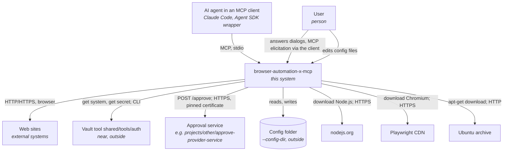
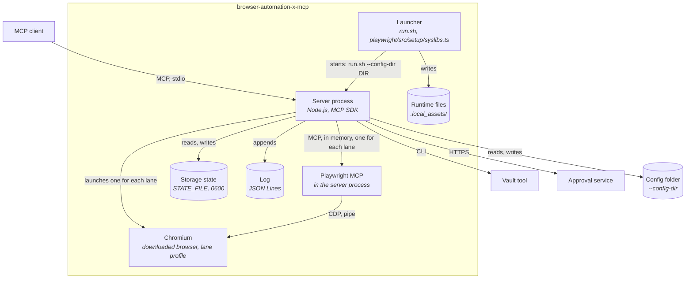
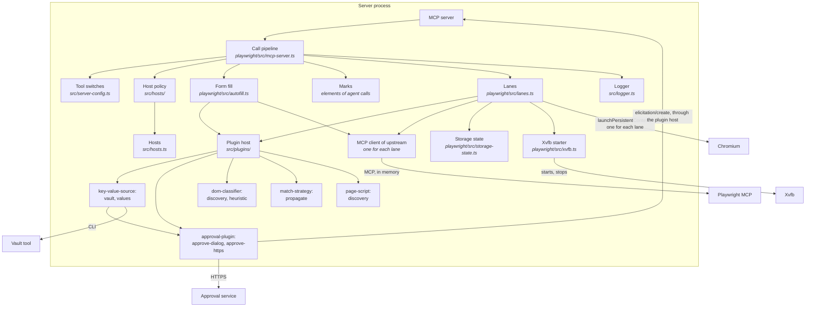
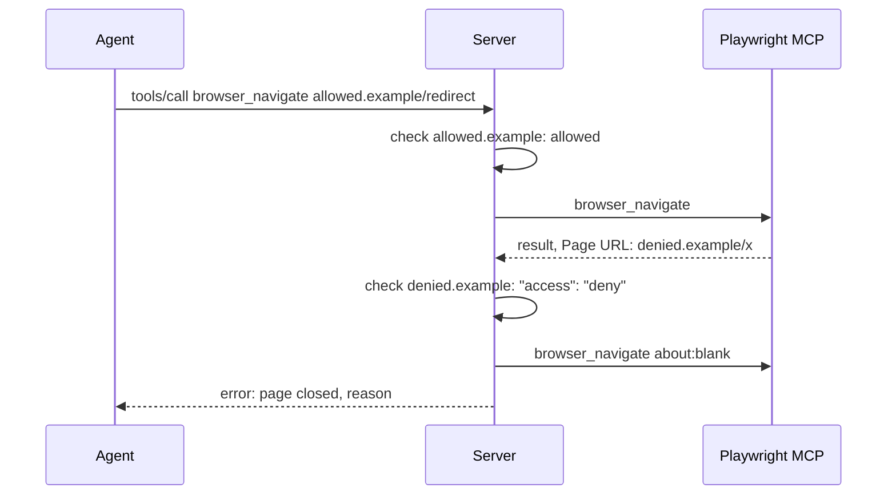
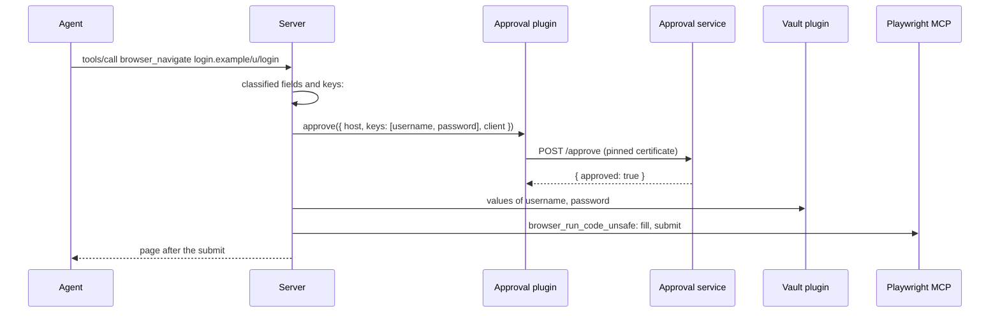

# Design — browser-automation-x-mcp

The intended architecture. For the reasons, see [ADL.md](ADL.md). Values in uppercase are
defined in [SRS.md](SRS.md#default-values) and [QAS.md](QAS.md#default-values).

## 1. Overview

The tool is an MCP server for browser automation. It runs on stdio between an MCP client (Claude
Code, a wrapper with the Agent SDK) and Playwright MCP. It forwards the browser tools, and it adds
tool switches, an automatic form fill, host lists and lanes. A lane is one browser context for one
agent: agents and sessions use the browser in parallel. It runs without root and without OS
installs. The browser is always Chromium.

The server code is in `playwright/`. The code in `src/`, the plugins (`plugins/`) and the
config templates in `config/` are the parts that do not use Playwright. The code is TypeScript in
strict mode. Node runs the `.ts` files with type stripping; there is no build step. The config files are in a config folder of the repository that uses the tool, e.g.
`local/configs/browser-automation-x-mcp`.

The internals are hidden from the agent. The agent sees the server `browser-automation-x-mcp` with
the browser tools. No text for the agent names upstream, Playwright, the form fill or its plugins
(REQ-005 of SRS). Deny rules of the agent tools close the tool folder and the config folder to the
agents (section 9).

## 2. Architectural drivers

- Functional requirements: [SRS.md](SRS.md)
- Quality attributes: [QAS-001](QAS.md#qas-001--portable-start-on-ubuntu) to [QAS-005](QAS.md#qas-005--overhead-of-the-server)
- Constraints:
  - The tool lives in the `shared` container. It writes files only into its folder (rules
    nothing-outside-repo, per-project-runtimes).
  - Secrets come only from the vault tool `shared/tools/auth` (rule credentials-from-vault).
  - No OS package installs, no root.
  - The client starts the server as a child process (stdio).

## 3. System context (C4 level 1)

System boundary: the tool folder `shared/tools/browser-automation-x-mcp/`. The vault tool and
the vault home are near, but outside.



- **AI agent in an MCP client:** calls the browser tools. It does not know the form fill. It gets
  the page after the submit, with MASK in place of masked values.
- **User:** configures the tool, adds the credentials of a site, fills the forms that the
  discovery recorder learns, answers the dialogs of the approval plugin.
- **Web sites:** the pages that the agent opens.
- **Vault tool:** gives the secrets of the `vault` plugin.
- **Approval service:** approves or refuses a fill for the `approve-https` plugin (REQ-036b of
  SRS). The workspace has a service that approves each request.
- **nodejs.org, Playwright CDN, Ubuntu archive:** the sources of the runtime, the browser and the
  missing Linux libraries.

## 4. Containers (C4 level 2)



- **Launcher:** makes and updates the runtime: Node.js, npm packages, Chromium and the missing
  Linux libraries and fonts. Then it starts the server with its arguments. stdout stays free for
  MCP.
- **Server process:** the MCP server for the client. It launches one Chromium and one Playwright
  MCP connection for each lane. It runs the call pipeline (section 5.1).
  It opens no network port.
- **Playwright MCP:** `@playwright/mcp`, unchanged, through `createConnection()` in the server
  process. It runs the browser tools in the context of a lane.
- **Chromium:** the browser of Playwright, from the tool folder. One process for each lane, with a
  persistent profile in LANES_DIR that the server writes before the start and deletes at the close
  (REQ-016, REQ-065 of SRS).
- **Storage state:** STATE_FILE: the cookies, localStorage and listed IndexedDB of all lanes and
  sessions of the workspace (REQ-064 of SRS). Mode `0600`; never in a result, a log or OUTPUT_DIR.
- **Xvfb:** the virtual display of a headed browser on Linux without a display. One for each
  server: it starts with the first lane and stops after the last lane. Unpacked into the tool
  folder.
- **Config folder:** outside the tool folder; `--config-dir` gives it (REQ-019 of SRS). It holds
  `server.json` (plugin instances, tool switches), `hosts.json` (a tree of hosts with their
  access) and the files of the plugins, e.g. the vault file and the discovery file. A missing
  `server.json` or `hosts.json` is a copy of its template in the tool folder. The server adds
  missing tools to `server.json`, and writes `hosts.json` only as REQ-042 of SRS says. The plugins
  read and write their own files.
- **Log:** two files for each server start in LOG_DIR/`<client>`/: `.log` for a person and
  `.log.json` with all fields (REQ-050 of SRS); gitignored.
- **Runtime files:** Node.js, browsers, libraries, temp files, STATE_FILE; gitignored.
- **Output files:** OUTPUT_DIR in the working folder: files with a `filename` of the agent.
  LANE_OUTPUT_DIR holds one folder for each open lane: the snapshots, long results and other files
  of the lane. The result gives the path and the size (REQ-014b, REQ-014c of SRS).

## 5. Components (C4 level 3)

### 5.1 Server process



Each component has an interface and a class that implements it. The constructors get the
dependencies. `startServer()` of `playwright/src/mcp-server.ts` is the composition root: it makes
the objects. No mutable state is at module level. The state of one lane for the call steps is a
`LaneSession` (`playwright/src/session.ts`).

- **MCP server / MCP client:** the SDK objects for the connections. The server forwards roots,
  progress and cancellation between the client and the connection of the lane.
- **Call pipeline:** the steps of one call, in this order: tool switch → lane tools, or the lane of
  the call (REQ-061 of SRS) → file name check (REQ-014a) → host check of the target URL → marks of
  the elements of the call → upstream → host check of the opened page → login link and form fill,
  with a host check of each page after a submit → scrub of masked values and secret headers
  (REQ-032, REQ-032a) → removal of the code sections → log. Each lane has its own call state (page
  URL, fill state).
- **Marks:** before a call with a `ref`, the server marks the element of the `ref` in the page
  (REQ-031e).
- **Lanes:** `playwright/src/lanes.ts` (section 7 of SRS). Opens and closes lanes, keeps
  MAX_LANES and MAX_TABS_PER_LANE, closes idle lanes, and starts and stops the Chromium of each
  lane and the Xvfb of the server. It writes the lane profile with
  `playwright/src/chrome-prefs.ts` (REQ-016), loads the storage state with `setStorageState()` for
  the browser session `normal`, saves it for `normal` and `fresh` (REQ-062, REQ-064),
  and adds a page script that reports the input of the user (REQ-066). It gives the context of a
  new lane to the plugin host for the page scripts, and tells the plugin host when a lane closes.
  At the start of the server, it deletes the lane profiles of servers that do not run.
- **Storage state:** `playwright/src/storage-state.ts`. Reads STATE_FILE, removes the IndexedDB of
  hosts that no node of `hosts.json` covers, merges the state of a lane into the file, and writes
  it with mode `0600` (REQ-064). The lanes save at each page load and at the close.
- **Server config:** `src/server-config.ts` reads `server.json`: the plugin instances of each
  category that are on, in the order of the array.
- **Tool switches:** `src/server-config.ts` with `tools` of `server.json` and the dangerous tools
  of Playwright MCP; adds missing tools; gives the error of a disabled tool.
- **Hosts:** `src/hosts.ts` reads `hosts.json` as a tree: root domains with `subdomains`
  (REQ-037 of SRS). It checks the tree at each load. It gives the chain of nodes of a host and the
  access of a host (a deny in the chain wins, else the nearest node, else `defaultAccess`). It
  writes the opened hosts (REQ-042). The root domain comes from the Public Suffix List (`tldts`).
- **Host policy:** `src/hosts/host-policy.ts` checks the access of the hosts.
- **Form fill:** `playwright/src/autofill.ts`. It runs page code through
  `browser_run_code_unsafe` of upstream. It runs the dom-classifiers of the plugin host in each
  frame, gets the keys from the match-strategies and the values from the key-value-sources, fills
  the fields, and runs the submit method of the dom-classifier (REQ-030, REQ-038 of SRS). The page
  code keeps a reference of each classified element in the page; the server gets no element
  object. It waits FLOW_WAIT for a field in a login flow, else until the page settles (SETTLE_QUIET, at
  most PEEK_WAIT) one time for each URL. It does not run after the read-only tools of REQ-030. It logs
  `fill_no_field` when a login flow ends on a page without a classified field. The tool switch of
  the agent does not apply to these calls. Their results never go to the agent. It keeps the loop
  guard of the lane. Before the fill, it clicks a visible login link of a dom-classifier, one time
  for each lane and host, if a key-value-source has keys for the page (REQ-030a). After the fill,
  it opens again the URL of the click. It marks the elements that it touches (REQ-031e). A blocked
  page after a submit stops the fill (REQ-030). It has no code that finds fields.
- **Plugin host:** `src/plugins/`. It has the interface of each plugin category and the types of
  its data. It loads the instances of `server.json` from `plugins/<category>/<plugin>/`, gives
  each one its config and a logger, and gives the approval plugins the MCP elicitation (REQ-031).
  For a key-value-source with `approval`, it attaches the approval plugin. It gives the values of
  the keys of one fill, with one approval for each approval plugin (REQ-031a, REQ-036c). It
  merges the results of the dom-classifiers (REQ-031b) and asks the match-strategies in order
  (REQ-031c). The page scripts are in `playwright/src/page-scripts.ts`: it injects them into each
  frame of a lane, keeps the channel to their Node code (binding `__baxPage`), and replaces each
  value of a message with its keys (REQ-031d). The page code of the server (classification, fill,
  submit, marks) is in `playwright/src/page-code.ts`. It scrubs the values
  of masked instances from the results and from the text files that upstream wrote in the call
  (REQ-032). It never gives a server object or a Playwright object to a plugin.
- **Plugins:** `plugins/<category>/<plugin>/`. Shared plugin code is in `plugins/common/<plugin>/`.
  - key-value-source: `vault` (REQ-034) takes the vault system from its own file; `values`
    (REQ-035).
  - approval-plugin: `approve-dialog` (REQ-036a) and `approve-https` (REQ-036b).
  - dom-classifier: `discovery` (REQ-039b) reads the discovery file; `heuristic` (REQ-039c) finds
    fields and submit methods from the attributes and the forms of the page.
  - match-strategy: `propagate` (REQ-039d) uses the hint of a field as its key.
  - page-script: `discovery` (REQ-039, REQ-039a) records the actions of the user and writes the
    discovery file.
  - `plugins/common/discovery/`: the format of the discovery file, for both `discovery` plugins.
- **Xvfb starter:** `playwright/src/xvfb.ts`. `renderMode()` of `playwright/src/config.ts`
  resolves `RENDER_MODE` (REQ-015 of SRS). For `HEADED_INVISIBLE`, the lanes start Xvfb through
  `setpriv --pdeathsig KILL` before Chromium, record it in XVFB_DIR and give its `DISPLAY` to
  Chromium. At each start, the server kills the Xvfb of servers that do not run (REQ-018).
- **Entry point:** `playwright/src/server.ts` takes only `--config-dir`. It sets the browsers
  path, the cache folder, the temp folder and the libraries in the process environment before it
  loads Playwright: Playwright reads them once.
- **Logger:** `src/logger.ts`. It keeps the events in a buffer until `initialize` gives the client
  name, then writes `.log.json` and the short lines of `.log`. It redacts the secret arguments.

### 5.2 Launcher

- **`run.sh`:** steps 1–4: Node.js (checksum), npm packages (when
  `package-lock.json` changes), Chromium (for each Playwright version), Linux libraries.
- **`playwright/src/setup/syslibs.ts`:** `ldd` → soname → package (Debian rule and an exception table) →
  `apt-get download` → `dpkg-deb -x`, in rounds; private apt lists if the system has none; fonts;
  Xvfb with the patched path of `xkbcomp` (REQ-017 of SRS).

## 6. Interfaces

### 6.1 Container interfaces

| Container | Operation | Description |
| --- | --- | --- |
| Server process | MCP `initialize` | Gives SERVER_NAME, the tools capability and the instructions of REQ-005. |
| Server process | MCP `tools/list` | The lane tools (REQ-060 of SRS), and the tools of upstream with the required parameter `lane`, without the name Playwright; notes for disabled tools. |
| Server process | MCP `tools/call` | The call pipeline (5.1). Error results: UI-02 of SRS. |
| Server process | MCP `elicitation/create` (to the client) | The dialog of the approval plugin `approve-dialog` (UI-03). |
| Server process | arguments | `--config-dir DIR` (necessary; REQ-019 of SRS). Each other argument stops the server (REQ-004). |
| Server process | environment | `RENDER_MODE` (REQ-015 of SRS); `BROWSER_AUTOMATION_X_MCP_LOG_DIR`, `_LOG_LEVEL`, `_LOG_SECRETS`, `_STORAGE_STATE`; `BROWSER_AUTOMATION_X_MCP_VAULT_TOOL` (tests: a test double of the vault tool). The server ignores each `PLAYWRIGHT_MCP_*` variable. |
| Playwright MCP (used) | `createConnection(config, contextGetter)` | One connection for each lane, with the context of the lane. |
| Playwright MCP (used) | `browser_run_code_unsafe`, `browser_snapshot` | Page code of the form fill and of the dom-classifiers; the snapshot after the submit. |
| Playwright (used) | `addInitScript`, `exposeBinding` of the lane context | The page scripts of the plugins and their channel. |
| Launcher | `run.sh [install|test|args]` | Makes the runtime; `install` stops after it; `test` runs the tests. |
| Vault tool (used) | `run.sh --vault NAME get-system SYSTEM` / `get-secret SYSTEM KEY` | The secret names of one system; one secret on stdout. |
| Approval service (used) | `POST <address>/approve` `{ host, keys, client }` → `{ approved }` | TLS with a pinned SHA-256 fingerprint, no authentication (REQ-036b of SRS). |

### 6.2 Component interfaces

| Component | Interface | Used by |
| --- | --- | --- |
| Call pipeline | Runs one tool call of the client through the steps of 5.1 | MCP server |
| Lanes | Opens, closes and lists lanes; gives the lane of a call | Call pipeline |
| Storage state | Loads, filters, merges and writes the storage state | Lanes |
| Host policy | Checks a URL; records an opened host | Call pipeline |
| Hosts | Reads the tree of `hosts.json`; gives the chain and the access of a host; writes an opened host | Host policy, storage state |
| Tool switches | Says if a tool is on; gives the error of a disabled tool; adds missing tools | Call pipeline |
| Server config | Gives the plugin instances of each category | Plugin host |
| Form fill | Fills and submits the classified fields of the page of a lane | Call pipeline |
| Marks | Marks the element of a call with a `ref` | Call pipeline |
| Page code | Runs a function in the page of a lane through upstream | Form fill |
| Lane session | Holds the state of one lane for the call steps: page URL, fill state, notes | Call pipeline, form fill |
| Plugin host | Loads the plugins; gives values, approvals, classified fields, keys; runs the page scripts and their channel; scrubs masked values | Form fill, lanes, call pipeline |
| key-value-source | Gives the keys of a page, the values of keys, and the keys of a value | Plugin host |
| approval-plugin | Approves the fill of the keys of one instance on a host | Plugin host |
| dom-classifier | Gives the fields, the submit methods and the login links of a frame | Plugin host |
| match-strategy | Gives the key of a field | Plugin host |
| page-script | Runs a script in each frame, with Node code beside it | Plugin host |
| Logger | Writes the events of the server and of the plugins | All |

## 7. Key flows

Two agents in parallel:

```mermaid
sequenceDiagram
    Agent A->>Server: browser_lane_open
    Server->>Server: start the Chromium of the lane; state of STATE_FILE
    Server-->>Agent A: Lane: lane-3f9a
    Agent B->>Server: browser_lane_open
    Server-->>Agent B: Lane: lane-07c1
    par
        Agent A->>Server: browser_navigate lane=lane-3f9a
        Server->>Playwright MCP: browser_navigate (connection of lane-3f9a)
    and
        Agent B->>Server: browser_navigate lane=lane-07c1
        Server->>Playwright MCP: browser_navigate (connection of lane-07c1)
    end
    Agent A->>Server: browser_lane_close lane=lane-3f9a
    Server->>Server: merge the state of the lane into STATE_FILE; stop its Chromium
    Agent B->>Server: browser_lane_close lane=lane-07c1
    Server->>Server: merge the state; stop its Chromium; stop Xvfb (last lane)
```

Form fill of a login page:

```mermaid
sequenceDiagram
    Agent->>Server: tools/call browser_navigate login.example/u/login
    Server->>Playwright MCP: browser_navigate
    Playwright MCP-->>Server: result, Page URL: login.example/u/login
    Server->>Server: host check
    Server->>Playwright MCP: browser_run_code_unsafe: run the dom-classifiers, wait for a field (PEEK_WAIT)
    Playwright MCP-->>Server: fields with hints, submit methods
    Server->>Match-strategy: keys of the fields
    Server->>Vault plugin: value of "password" on login.example
    Vault plugin->>Vault tool: get-secret "System" password
    Vault tool-->>Vault plugin: secret
    Server->>Playwright MCP: browser_run_code_unsafe: fill, submit method, wait (SUBMIT_WAIT)
    Server->>Playwright MCP: browser_snapshot
    Playwright MCP-->>Server: page after the submit (may show a value)
    Server->>Server: host check; scrub: value → ***; remove code sections
    Server-->>Agent: page after the submit
```

A redirect to a denied host:



Discovery of a login form (the vault file has a system for login.example):

```mermaid
sequenceDiagram
    User->>Browser: fills username, password; clicks Sign in
    Browser->>Page script discovery: input, click events
    Page script discovery->>Server: message: press #signin, values of the user fields
    Server->>Vault plugin: keys of each value
    Vault plugin->>Vault tool: get-system, get-secret for each secret
    Vault plugin-->>Server: username, password
    Server->>Server: discard the values
    Server->>Node code of discovery: message: press #signin, keys username, password
    Node code of discovery->>Discovery file: fields: { "#user": "username", "#pass": "password" }, submit: ["#signin"]
```

Approval of a fill:



## 8. Data model

| File | Committed | Format | Written by |
| --- | --- | --- | --- |
| `<config>/server.json` | yes | `plugins`: `{ <category>: [<instance>] }` for `key-value-source`, `dom-classifier`, `match-strategy`, `page-script`; instance: `{ name, plugin, description, enabled, config }`; a key-value-source also has `mask` and optional `approval: { plugin, enabled, config }`; `tools`: `{ <tool>: { enabled } }`, sorted; `recordHosts` (RECORD_HOSTS) | user; server adds missing tools |
| `<config>/hosts.json` | yes | `defaultAccess`; `hosts`: `{ <root domain>: <node> }`; node: `{ access, subdomains: { <host>: <node> } }` (REQ-037, REQ-040 of SRS) | user; server (REQ-042) |
| `<config>/<vault file>` | yes | `hosts`: the tree of `hosts.json`; node: `{ system, subdomains }` (REQ-034) | user |
| `<config>/<discovery file>` | yes | `hosts`: the tree of `hosts.json`; node: `{ forms: [{ fields: { <css>: <key> }, submit: [<matcher> or "enter"] }], login: [<matcher>], subdomains }`; matcher: `<css>` or `{ css, text }` (REQ-039a, REQ-039b) | user; page-script `discovery` |
| `config/server.template.json`, `config/hosts.template.json` | yes | the first content of each file above | user; server copies a template to a missing file |
| `LOG_DIR/<client>/<mm-dd_hhmmss_pid>.log.json` | no | JSON Lines: `ts`, `level`, `session`, `event`, fields of the event | server |
| `LOG_DIR/<client>/<mm-dd_hhmmss_pid>.log` | no | `HH:MM:SS <event> <url> <key>=<value> ...`, a maximum of LOG_LINE_MAX characters | server |
| STATE_FILE | no | Playwright storage state (JSON): `cookies`, `origins` with `localStorage` and `indexedDB`; mode `0600` | server |
| LANES_DIR | no | `<pid>-<lane id>/`: the Chromium profile of an open lane, with `Default/Preferences` | server, Chromium |
| `.local_assets/` | no | runtime, browsers, `syslibs/<platform>/root` (also Xvfb), `xvfb/<display>.json` (PID and start time of the server and Xvfb), tmp, STATE_FILE, LANES_DIR | launcher, Playwright, server |
| OUTPUT_DIR | no | the only folder for a `filename` of the agent (REQ-014a); LANE_OUTPUT_DIR is in it | Playwright; server scrubs and masks |
| LANE_OUTPUT_DIR | no | `<pid>-<lane id>/`: snapshots, long results, screenshots, console logs, network files of an open lane (REQ-014b, REQ-014c) | Playwright, server; server scrubs and masks |
| `.local_assets/tmp/` of the first folder with `.git` above the tool (e.g. `shared/`) | no | temp files of Chromium when the tool folder cannot hold its socket; then the temp folder of the OS | Playwright |

Hosts: a host key is a root domain; a `subdomains` key is a full host name under its node. A node
covers its host and each subdomain of it. `access` goes down the tree. No case. A URL without a
host passes. The plugin files use the same tree.

Plugin APIs (`src/plugins/`, reviewed in section H of ADR-20261108-plugin_architecture). A plugin
gets only JSON data, its `PluginContext` (`name`, `config`, `configDir`, `logger`) and, for an
approval plugin, a `Dialog` in each call. `PageInfo` is `{ url, host, hosts }`; `hosts` is the
host, then its parents, to the root domain.

| Category | File | Operations |
| --- | --- | --- |
| all | `plugin.ts` | `PluginContext`, `PageInfo`, `PluginLogger`; optional `dispose()` |
| key-value-source | `key-value-source.ts` | `keys(page)` → keys; `values(keys, page)` → `{ key: value }`; `keysOf(value, page)` → all keys; `SourceError` |
| approval-plugin | `approval-plugin.ts` | `approve({ host, keys, client }, dialog)` → boolean; `Dialog.ask(message, form, timeout)` |
| dom-classifier | `dom-classifier.ts` | `pageScript()` → source of a `ClassifyFunction<I>`; `pageInput(page)` → `I` or undefined. The page code gives `{ fields: [{ element, hint }], submits: [click, enter or requestSubmit, with the served elements], logins: [element] }` |
| match-strategy | `match-strategy.ts` | `match(fields: [{ ref, hint }], keys, page)` → `[{ ref, key }]` |
| page-script | `page-script.ts` | `pageScript()` → source of a `PageScriptFunction<M>`; `onMessage({ lane, data, identified: [{ id, keys }] }, page)`; `laneClosed(lane)`. The page code gets `PageApi<M>`: `send(data, values: [{ id, value }])`, `touchedByServer(element)` |

`<config>` is the config folder that `--config-dir` gives, e.g. `local/configs/browser-automation-x-mcp`
of the repository.

## 9. Deployment

- Deployment, configuration and client setup: [README.md](../README.md).
- The deny rules of the agent tools close the tool folder, the config folder and `.mcp.json` to the
  agents: `permissions.deny` in the root `.claude/settings.json`, and the matching settings of the
  other agent tools. The output folder stays open.

| Dependency | Container | Use |
| --- | --- | --- |
| Node.js NODE_VERSION (downloaded) | Launcher, server | Runtime |
| `@playwright/mcp` 0.0.83 (with its `playwright-core`) | Server process | Browser tools; Chromium launch |
| `@modelcontextprotocol/sdk` 1.32.2 | Server process | MCP server and client |
| `tldts` 7.4.18 | Server process | Root domain of a host (Public Suffix List) |
| `typescript`, `@types/node`, `eslint`, `typescript-eslint` (dev, pinned) | Tests | Type check and lint |
| Chromium (downloaded) | Chromium | Browser |
| `ldd`, `apt-get`, `apt-cache`, `dpkg-deb` (Ubuntu base) | Launcher | Missing libraries, no root |
| `curl`, `tar`, `sha256sum` / `certutil` | Launcher | Download of Node.js |
| Vault tool `shared/tools/auth` | Plugin `vault` | Secrets |
| Approval service, e.g. `projects/other/approve-provider-service` of the workspace | Plugin `approve-https` | Approvals |

Test phases (section "Verification" of the SDD workflow): `run.sh test` runs all phases;
`run.sh test <phase>` runs one phase. A failure does not stop the run. A passed test gives a short
summary; a failed test gives its full output.

| Phase | Folder |
| --- | --- |
| Static analysis: `tsc --noEmit`, lint | `tests/static/` |
| Unit | `tests/unit/` |
| Functional | `tests/functional/` |
| Online and QAS | `tests/online/` |

Manual test: see [README.md](../README.md#tests), and run `claude -p` with `--mcp-config` as
[README.md](../README.md#client-setup) says.

## 10. Architecture decisions

All decisions are in [ADL.md](ADL.md).

- [ADR-20261108-plugin_architecture](adr/ADR-20261108-plugin_architecture.md): plugins in place of
  the form-fill providers; the discovery as plugins; `hosts.json`; TypeScript.

- [ADR-20261106-domain_tree_and_provider_config](adr/ADR-20261106-domain_tree_and_provider_config.md):
  `sites.json` as a tree of root domains and subdomains; `provider-config`; approval attached to a
  key-value provider. `provider-config` is superseded by ADR-20261108-plugin_architecture.
- [ADR-20261106-provider_kinds_and_matching](adr/ADR-20261106-provider_kinds_and_matching.md):
  key-value, value and approval providers; discovery writes `sites.json` with the keys of the
  values that the user filled. Superseded by ADR-20261108-plugin_architecture.
- [ADR-20261104-browser_lanes](adr/ADR-20261104-browser_lanes.md): one browser context for each
  agent, upstream in the server process, logins in a storage-state file.
- [ADR-20261028-tool_folders](adr/ADR-20261028-tool_folders.md): one folder for each browser
  tool, shared providers and config. Superseded: the tool has one browser tool only (ADL
  20261103-01).

## 11. Open issues

- A pop-up (MCP elicitation) for hosts that `hosts.json` does not allow.
- The approval service approves each request. A service with real decisions (e.g. a confirmation
  on a phone) is open.
- A value of the user can match a wrong key, e.g. a username that is also an email.
- Proof of QAS-001 in clean Ubuntu 22.04 and 24.04 containers, with instructions (B3).
- CJK fonts (`fonts-noto-cjk`, 58 MB) for screenshots of Chinese, Japanese and Korean text.
- `libgssapi-krb5-2` for Kerberos sign-on on hosts without it (lazy-loaded by Chromium).
- In `claude -p` (no UI), Claude Code cancels each dialog of the approval plugin `approve-dialog`.
  The server does not fill the form.
- `browser_evaluate` can read a value that stays in a field after a failed submit.
- A deny rule does not stop each shell command. An agent with a shell can still read the tool
  folder.
- The bubble tests of REQ-016 ran on Xvfb: the password and address bubbles on `http://127.0.0.1`,
  the translate bubble on amazon.pl. They are manual tests.
- A site that keeps the same link text after the login needs an other sign for the login link
  (REQ-030a). Not supported.
- A dom-classifier with an agent, which gives richer hints, is not made.
- The fill scope without the discovery file: the `heuristic` classifier with `"fields": true` cannot
  tell a login from a form that asks for the password to confirm an action (e.g. a deletion). It
  fills and submits such a form on a host of the vault file.
- Each call that can change the page costs one classification (about 0.5 s with the
  `browser_run_code_unsafe` round trip of upstream), also on a page without fields.
- A dom-classifier with Fathom is not made. Firefox uses Fathom in production only for new-password,
  sign-up and credit card fields; its login ruleset is a proof of concept.
- An element that `browser_evaluate` changes has no mark: the discovery recorder records it as an
  element of the user.
- The page scripts run in the main world of the page. The scripts of the site can see the marks
  and the page APIs of the server.
- Two lanes of the same agent are possible. The server cannot see which agent makes a call.

## 12. Default values

See [SRS.md](SRS.md#default-values) and [QAS.md](QAS.md#default-values).
