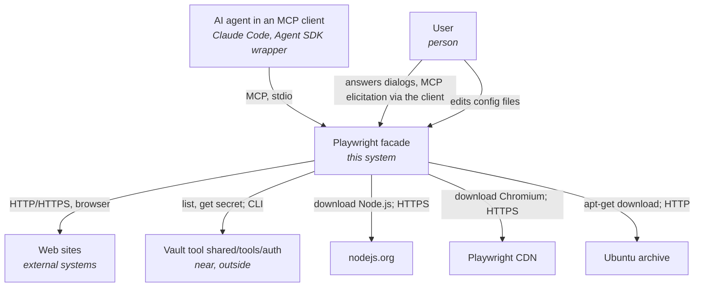
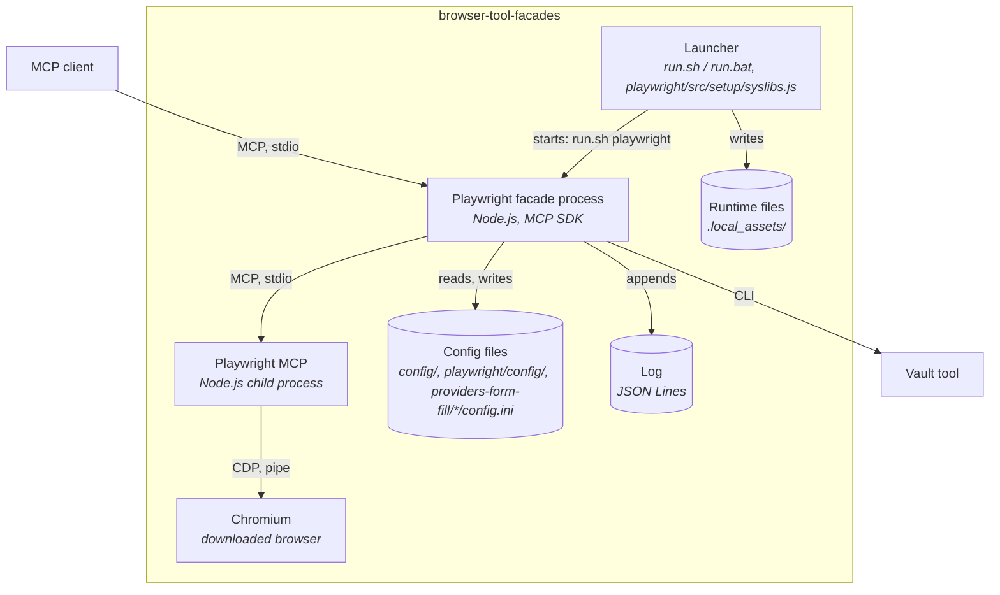
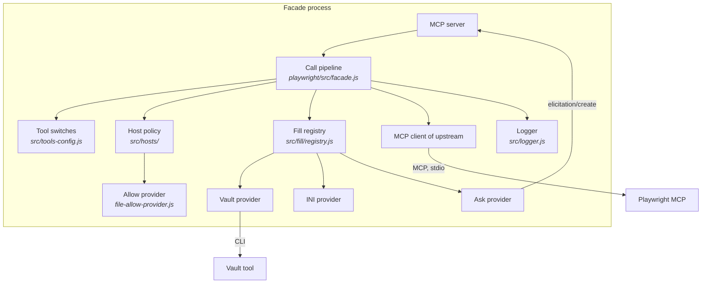
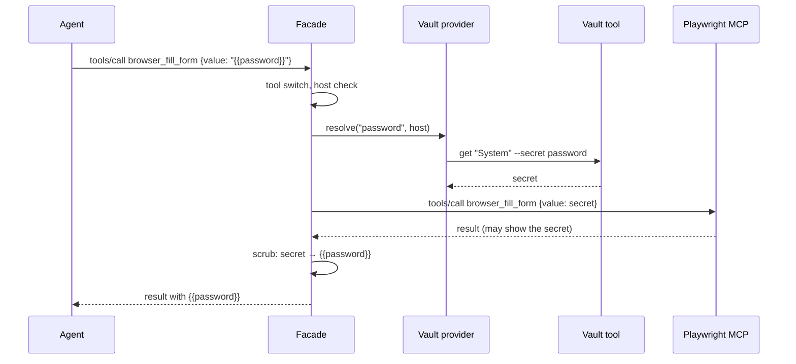
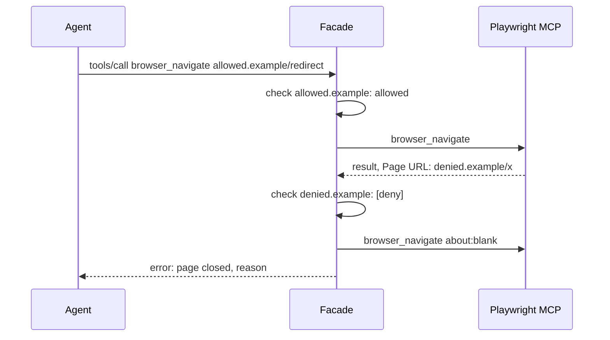
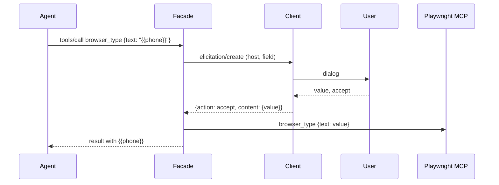

# Design — browser-tool-facades

The intended architecture. For the reasons, see [ADL.md](ADL.md). Values in uppercase are
defined in [SRS.md](SRS.md#default-values) and [QAS.md](QAS.md#default-values).

## 1. Overview

The tool holds facades for browser tools. Each facade has its own folder (`playwright/`). The
facades share the launcher, the runtime, the code in `src/`, the form-fill providers
(`providers-form-fill/`) and the config in `config/`. A second facade is an open issue
(section 11).

The Playwright facade is an MCP server on stdio between an MCP client (Claude Code, a wrapper with
the Agent SDK) and Playwright MCP. It forwards the browser tools, and it adds tool switches,
placeholders for form values and host lists. It runs without root and without OS installs.

## 2. Architectural drivers

- Functional requirements: [SRS.md](SRS.md)
- Quality attributes: [QAS-001](QAS.md#qas-001--portable-start-on-ubuntu) to [QAS-005](QAS.md#qas-005--overhead-of-the-facade)
- Constraints:
  - The tool lives in the `shared` container. It writes files only into its folder (rules
    nothing-outside-repo, per-project-runtimes).
  - Secrets come only from the vault tool `shared/tools/auth` (rule credentials-from-vault).
  - No OS package installs, no root.
  - The client starts the facade as a child process (stdio).

## 3. System context (C4 level 1)

System boundary: the tool folder `shared/tools/browser-tool-facades/`. The vault tool and
the vault home are near, but outside.

- **AI agent in an MCP client:** calls the browser tools; writes placeholders, never user data.
- **User:** configures the tool, edits the host list, answers the dialogs of the ask provider.
- **Web sites:** the pages that the agent opens.
- **Vault tool:** gives the secrets of the vault provider.
- **nodejs.org, Playwright CDN, Ubuntu archive:** the sources of the runtime, the browser and the
  missing Linux libraries.

## 4. Containers (C4 level 2)

- **Launcher:** one for all facades. It makes and updates the shared runtime: Node.js, npm
  packages, and for the Playwright facade Chromium and the missing Linux libraries and fonts.
  Then it starts the facade that its first argument names. stdout stays free for MCP.
- **Playwright facade process:** the MCP server for the client and the MCP client of Playwright
  MCP. It runs the call pipeline (section 5.1). An other facade is an other process of the same
  kind, with its own folder.
- **Playwright MCP:** `@playwright/mcp`, unchanged. It runs the browser tools.
- **Chromium:** the browser of Playwright, from the tool folder.
- **Config files:** committed. Shared by all facades: `config/facade.ini`, `config/hosts.ini`,
  `providers-form-fill/*/config.ini`. For one facade: `<facade>/config/tools.ini`. The facade adds
  tool lines and recorded hosts.
- **Log:** `LOG_FILE`, gitignored.
- **Runtime files:** Node.js, browsers, libraries, profiles, output, temp files; gitignored.

## 5. Components (C4 level 3)

### 5.1 Playwright facade process

The components with a path in `src/` and `providers-form-fill/` are shared: each facade process
loads them. The components with a path in `playwright/` are for this facade only.

- **MCP server / MCP client:** the SDK objects for the two connections. The facade forwards
  roots, progress, cancellation and tool-list changes between them.
- **Call pipeline:** the steps of one call, in this order: tool switch → host check of the target
  URL → placeholders → upstream → scrub → host check of the opened page and record → log.
- **Tool switches:** `src/tools-config.js` with `playwright/config/tools.ini` and the dangerous
  tools of Playwright MCP; adds missing tools; gives the error of a disabled tool.
- **Host policy:** `[deny]` first, then the allow provider. Patterns: `src/hosts/patterns.js`.
- **Allow provider:** the default reads `[allow]` and records each opened host.
- **Fill registry:** loads the providers in the order of `facade.ini`, fills the placeholders in
  the arguments that the facade gives (for Playwright: `browser_type.text`,
  `browser_fill_form.fields[].value`, `browser_select_option.values[]`), scrubs the results, gives
  `fill_values_list`.
- **Vault, INI, ask providers:** `providers-form-fill/<name>/index.js` with `providers-form-fill/<name>/config.ini`.
- **Logger:** JSON Lines; redacts the secret arguments.

### 5.2 Launcher

- **`run.sh` / `run.bat`:** steps 1–4: Node.js (checksum), npm packages (when
  `package-lock.json` changes), Chromium (for each Playwright version), Linux libraries.
- **`playwright/src/setup/syslibs.js`:** `ldd` → soname → package (Debian rule and an exception table) →
  `apt-get download` → `dpkg-deb -x`, in rounds; private apt lists if the system has none; fonts.

## 6. Interfaces

### 6.1 Container interfaces

| Container | Operation | Description |
| --- | --- | --- |
| Facade process | MCP `initialize` | Gives the tools capability of upstream and the instructions for placeholders. |
| Facade process | MCP `tools/list` | The tools of upstream, then `fill_values_list`; notes for disabled tools and placeholders. |
| Facade process | MCP `tools/call` | The call pipeline (5.1). Error results: UI-02 of SRS. |
| Facade process | MCP `elicitation/create` (to the client) | The dialog of the ask provider (UI-01). |
| Facade process | arguments | Each argument goes to Playwright MCP, e.g. `--headless`, `--isolated`. |
| Facade process | environment | `PLAYWRIGHT_FACADE_LOG_FILE`, `_LOG_LEVEL`, `_LOG_SECRETS`, `_CONFIG_DIR` (tools.ini); `BROWSER_FACADES_CONFIG_DIR`, `BROWSER_FACADES_PROVIDERS_CONFIG_DIR` (shared config). |
| Launcher | `run.sh [install|test|args]` | Makes the runtime; `install` stops after it; `test` runs the tests. |
| Vault tool (used) | `run.sh [--vault-home D] [--subvault S] list` / `get NAME --secret KEY` | Systems with url and secret names; one secret on stdout. |

### 6.2 Component interfaces

| Component | Interface | Used by |
| --- | --- | --- |
| Fill provider | `list(ctx)`: placeholder names; `resolve(name, ctx)`: value, `undefined`, or a `FillError`; `dispose()`. `ctx = { host, url, tool, field, elicit }`. See `src/fill/provider.js`. | Fill registry |
| Allow provider | `isAllowed(host, ctx)`; `recordOpened(host, ctx)`. `ctx = { url, tool }`. See `src/hosts/allow-provider.js`. | Host policy |
| Host policy | `check(url, ctx)` → `{ allowed, reason }`; `opened(url, ctx)` | Call pipeline |
| Tool switches | `addMissing(names)`, `isEnabled(name)`, `describe(tool)`, `disabledResult(name)` | Call pipeline |
| Fill registry | `fill(tool, args, ctx)`, `scrub(result)`, `list(ctx)` | Call pipeline |

## 7. Key flows

Tool call with placeholders:

A redirect to a denied host:

Dialog of the ask provider:

## 8. Data model

| File | Committed | Format | Written by |
| --- | --- | --- | --- |
| `config/facade.ini` | yes | `[fill] providers = vault, ini, ask`; `[hosts] record = true|false` | user |
| `playwright/config/tools.ini` | yes | `[tools]` `<tool> = enabled|disabled`, sorted | user; facade adds missing tools |
| `config/hosts.ini` | yes | header comments; `[deny]`, `[allow]`: one host pattern per line, sorted, unique | user; facade records hosts |
| `providers-form-fill/vault/config.ini` | yes | `[vault]` `vault_home`, `subvault`, `tool` (paths relative to the folder) | user |
| `providers-form-fill/ini/config.ini` | yes | `[all]` and `[<host pattern>]` with `key = value` | user |
| `providers-form-fill/ask/config.ini` | yes | `[ask]` `fields = a, b, c` | user |
| `LOG_FILE` | no | JSON Lines: `ts`, `level`, `session`, `event`, fields of the event | facade |
| `.local_assets/` | no | runtime, browsers, `syslibs/<platform>/root`, profiles, output, tmp | launcher, Playwright |

Host patterns: `*` (each host), `*.example.com` (subdomains only), `example.com` (exact),
`192.168.1.*` (IPv4 octets). Host only, no case. A URL without a host passes.

Placeholders: ``, the name is a letter, then letters, digits, `_`, `.`, `-`. No case.

## 9. Deployment

- Deployment and configuration: [README.md](../README.md), [playwright/README.md](../playwright/README.md),
  client setup: [playwright/docs/clients.md](../playwright/docs/clients.md).

| Dependency | Container | Use |
| --- | --- | --- |
| Node.js NODE_VERSION (downloaded) | Launcher, facade, Playwright MCP | Runtime |
| `@playwright/mcp` 0.0.83 | Playwright MCP | Browser tools |
| `@modelcontextprotocol/sdk` 1.32.2 | Facade process | MCP server and client |
| Chromium (downloaded) | Chromium | Browser |
| `ldd`, `apt-get`, `apt-cache`, `dpkg-deb` (Ubuntu base) | Launcher | Missing libraries, no root |
| `curl`, `tar`, `sha256sum` / `certutil` | Launcher | Download of Node.js |
| Vault tool `shared/tools/auth` | Vault provider | Secrets |

Manual test: see [playwright/README.md](../playwright/README.md#tests), and run `claude -p` with
`--mcp-config` as [playwright/docs/clients.md](../playwright/docs/clients.md) says.

## 10. Architecture decisions

All decisions are in [ADL.md](ADL.md).

- [ADR-20261028-facade_folders](adr/ADR-20261028-facade_folders.md): one folder for each facade, shared
  providers and config.

## 11. Open issues

- A second facade, for the browser that Claude opens in a chat of the Claude desktop app.
- Composite tools that combine Playwright tools, e.g. `fill_form_by_labels`.
- Location of the host list: maybe outside the committed config, per clone or per workspace.
- A pop-up allow provider (MCP elicitation) for hosts that are not in `[allow]`.
- A network fill provider.
- Proof of QAS-001 in clean Ubuntu 22.04 and 24.04 containers, with instructions (B3).
- CJK fonts (`fonts-noto-cjk`, 58 MB) for screenshots of Chinese, Japanese and Korean text.
- `libgssapi-krb5-2` for Kerberos sign-on on hosts without it (lazy-loaded by Chromium).
- In `claude -p` (no UI), Claude Code cancels each dialog of the ask provider. The call stops.

## 12. Default values

See [SRS.md](SRS.md#default-values) and [QAS.md](QAS.md#default-values).
