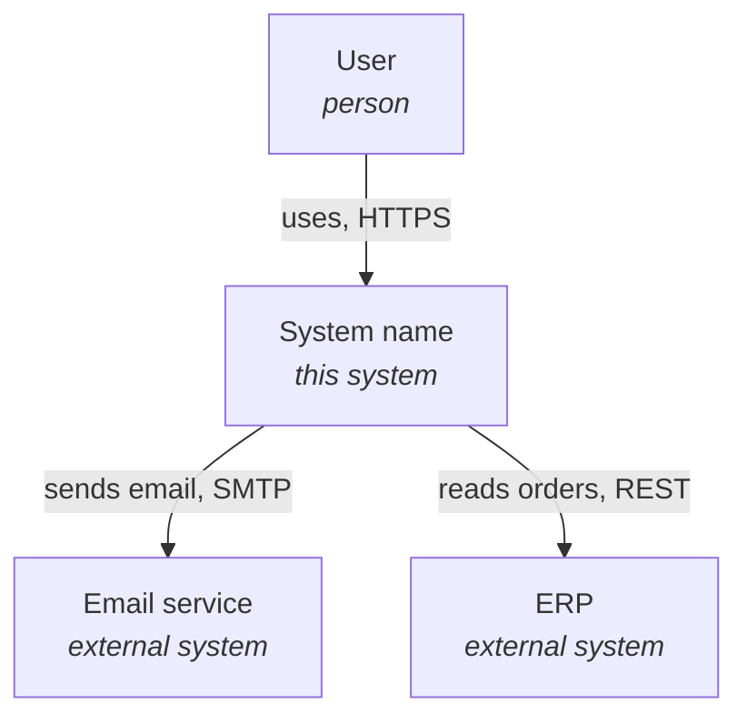
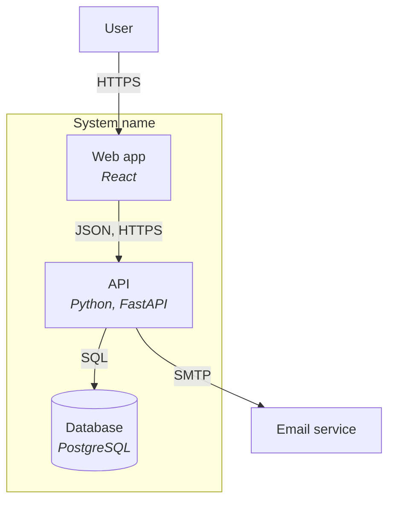
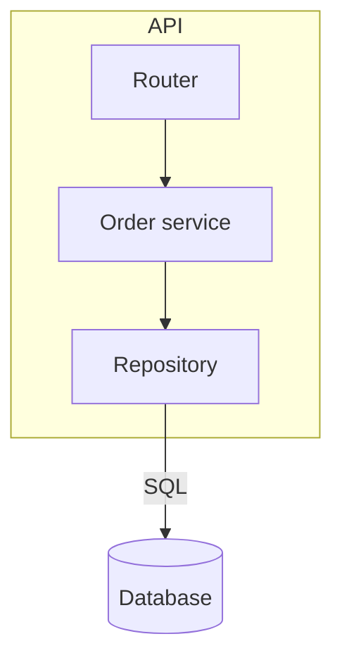
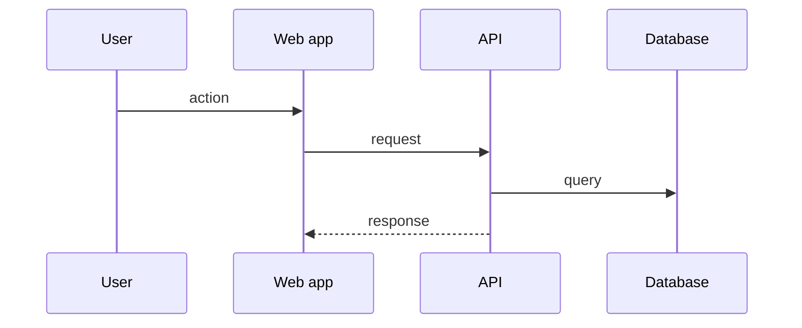
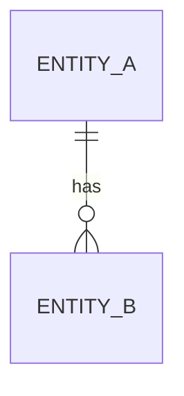

# Design — [system name]

The full view of the architecture, made during review and BEFORE implementation. This is the source of truth for the intended architecture. For the reasons, see the ADRs. The structure follows the C4 model, levels 1 to 3. Do not describe classes or code.

Draw diagrams as Mermaid `flowchart`, with C4 conventions: a labelled box for each element, `[( )]` for a data store, a `subgraph` for a boundary. Write the purpose and the protocol on each relation.

If section 5 of one container becomes too large, move it to `design/[container].md`. Keep a link to it in section 5.

Write a value as an uppercase name. Give its default in "Default values", or refer to the document that defines it.

## 1. Overview

One or two sentences: what it is and what problem it solves.

## 2. Architectural drivers

- Functional requirements: [links to SRS.md]
- Quality attributes: [links to QAS.md]
- Constraints:

## 3. System context (C4 level 1)

The system as a black box. Show the users, the external systems and the relations to them.

System boundary: [the elements inside the system, and the elements that are near it but outside, e.g. a local data store of another tool]

- **User:** role
- **Email service:** role
- **ERP:** role

## 4. Containers (C4 level 2)

The units that run or store data separately: applications, services, databases, queues. Give the technology of each one.

- **Web app:** responsibility
- **API:** responsibility
- **Database:** responsibility

## 5. Components (C4 level 3)

Write a subsection only for a container with a complex inside. Describe a component that more than one container uses in one subsection only. Refer to it from the other subsections.

### 5.1 [container name]

- **Router:** responsibility
- **Order service:** responsibility
- **Repository:** responsibility

## 6. Interfaces

### 6.1 Container interfaces

The public interfaces of each container, in detail. List each operation with a brief description. Give the schema of each message in section 8.

| Container | Operation | Description |
| --- | --- | --- |
| API | `GET /orders/{id}` | [brief description] |

### 6.2 Component interfaces

A list of the interface of each component, with a short description. Do not list functions or members.

| Component | Interface | Used by |
| --- | --- | --- |
| Order service | [short description] | Router |

## 7. Key flows

Sequence diagrams for the important flows between the containers.

## 8. Data model

Design the data before implementation: state, files, configuration, messages and their schemas. Use an ER diagram only for a database.

## 9. Deployment

Where each container runs, and the dependencies that each container needs. Keep this section empty if no deployment script or deployment instructions exist.

- Deployment and configuration: [INSTRUCTIONS.md](../INSTRUCTIONS.md) if a separate instructions file is necessary, else [README.md](../README.md).

| Dependency | Container | Use |
| --- | --- | --- |
| [package or tool] | [container] | [use] |

## 10. Architecture decisions

Summary and links to the ADRs. The full reasons are in the ADRs and the ADL.

- ADR-[yyyymmdd]-[topic]: [title]

## 11. Open issues

## 12. Default values

| Name | Default | Unit | Configuration key | Meaning |
| --- | --- | --- | --- | --- |
| [NAME] | [value] | [unit] | [key] | [meaning] |
